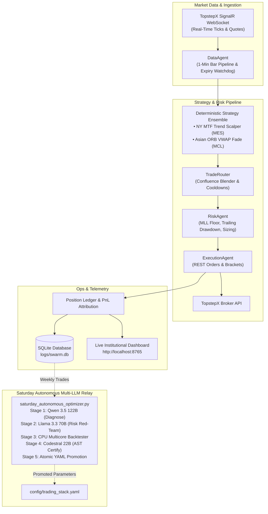

# TopstepX Trading Swarm (v2.5.2)

[](https://www.python.org/downloads/)
[](https://www.docker.com/)
[](LICENSE)
[](https://www.topstep.com)
[](https://developer.apple.com/metal/)

Autonomous, local-first algorithmic trading swarm engineered for **TopstepX Prop Combines** (Micro WTI Crude Oil `MCL`, Micro E-mini S&P 500 `MES`, and Micro Gold `MGC`).

Features real-time SignalR WebSocket streaming, REST order routing, bracket lifecycle tracking, an institutional live ops dashboard, and an autonomous offline Saturday Multi-LLM optimizer relay running locally on Apple Silicon Metal GPU.

**[Architecture](#1-system-architecture)** • **[Strategy Stack](#2-strategy-stack-example-configuration)** • **[Combine Safety](#3-risk-management--prop-combine-invariants)** • **[Quickstart](#4-quickstart--deployment)** • **[Saturday Optimizer](#5-saturday-autonomous-multi-llm-relay)** • **[License](#7-license--disclaimers)**

> **⚠️ Disclaimer:** This project is for **educational and research purposes only** and is **not financial advice**. Futures trading involves substantial risk of loss. The parameters shown here are examples from one author's research and are **not** a recommendation. Use at your own risk, only with your own TopstepX/ProjectX credentials, and start in `MODE=simulation`. See [LICENSE](LICENSE).

---

## 1. System Architecture



---

## 2. Strategy Stack (Example Configuration)

Strategies are configured deterministically in `config/trading_stack.yaml`. A generic starter file ships as [`config/trading_stack.example.yaml`](config/trading_stack.example.yaml); copy it and tune the values for your own research. The numbers below are the example defaults, not recommendations:

### A. Multi-Timeframe (MTF) Trend Scalper (`mtf_trend_scalper.py`)

- **Instruments:** configurable via `enabled_symbols` (example: `MES`).
- **Higher-Timeframe (HTF):** 15-minute EMA 21 / EMA 50 trend alignment.
- **Lower-Timeframe (LTF):** 5-minute ADX momentum filter (`min_adx`, example `25.0`).
- **Dynamic Brackets (ATR):** `sl_atr_mult` (example `1.5x`) and `tp_atr_mult` (example `3.0x`).
- **Session Trading Windows (ET):** `allowed_entry_hours_et` restricts which hours may open trades.

### B. Opening Range Breakout & VWAP Fade (`orb_vwap.py`)

- **Instruments:** configurable via `enabled_symbols` (example: `MCL`).
- **Asian Session:** opening range built `18:00–18:10` ET with a trade window to `20:30` ET; the NY-session range is disabled by default (`opening_range_enabled: false`).
- **Range filter:** `asian_min_or_ticks` / `min_or_ticks` skip sessions with too small an opening range.
- **Direction:** `asian_direction_mode` (`fade` or breakout) with `asian_risk_reward`.

---

## 3. Risk Management & Prop Combine Invariants

The bot enforces strict TopstepX combine safety inside [`src/agents/risk_agent.py`](src/agents/risk_agent.py):

1. **Maximum Loss Limit (MLL):** Hard equity floor preventing account breach.
2. **Trailing Drawdown Ceiling:** Real-time tracking against intraday high-water marks.
3. **Protective Stop Watchdog & Reconciliation Hardening:**
   - 30-second high-frequency watchdog (`_ensure_protective_stop_for_position`) verifies every open position has an active broker-side stop order, with TOCTOU locks, 30s grace window, 60s cooldown, and exact decimal tick rounding.
   - Broker REST methods (`search_open_positions`, `get_positions`, `get_orders`) return `None` on API timeouts rather than `[]`, preventing false state wipes.
   - SQLite persistence uses `PRAGMA journal_mode=DELETE` with `synchronous=FULL` and `busy_timeout=10000` to prevent VirtioFS shared-memory (`.db-shm`) desynchronization between macOS host and Docker Linux VM.
4. **Emergency Auto-Flattening:**
   - Pre-maintenance window flattening at 16:45 ET.
   - Heartbeat stall watchdog: Liquidates and disconnects if market data freezes for $>300$ seconds with open positions.
5. **Design Rule:** All features must either contribute deterministic parameters to the normal trade path or remain offline/observational. No hidden execution gates, runtime vetoes, or dynamic resizing during live trading hours.

---

## 4. Quickstart & Deployment

### Prerequisites

- Docker & Docker Compose
- Python 3.11+ (for local scripts / optimizer)
- Native Ollama (for offline Saturday Optimizer: `qwen3.5:122b`, `llama3.3:70b`, `codestral:22b`)

### Project Layout

```text
money-printer-maximum/
├── config/              # Strategy stack & loop parameter YAMLs
│   └── trading_stack.example.yaml
├── src/
│   ├── agents/          # Supervisor, Risk, Data, Execution agents
│   ├── api/             # TopstepX REST & SignalR WebSocket client
│   ├── strategies/      # Deterministic MTF Scalper & Asian ORB strategies
│   └── persistence/     # SQLite trade and session ledger
├── scripts/             # Saturday multi-LLM optimizer & backtesting tools
├── tests/               # 289-test hermetic test suite
├── Dockerfile           # Non-root container image definition
├── docker-compose.yml   # Production container orchestration
└── dashboard.py         # Institutional real-time monitoring web app
```

### Environment Setup

Copy the template and fill in your own credentials (never commit `.env`):

```bash
cp .env.template .env
```

```env
PROJECTX_API_KEY=your_api_key_here
PROJECTX_ACCOUNT_ID=your_account_id_here
TOPSTEPX_USERNAME=your_username_here
MODE=simulation              # "simulation" (paper, default) or "live"
ACTUAL_LIVE_TRADING=false    # must be "true" AND MODE=live for real orders
```

Then create your strategy config from the example (the live file is git-ignored so your tuned parameters stay private and the optimizer can rewrite it safely):

```bash
cp config/trading_stack.example.yaml config/trading_stack.yaml
```

The bot refuses to start if `config/trading_stack.yaml` is missing. The example uses generic starter values, not a recommendation.

Live orders are only sent when **both** `MODE=live` and `ACTUAL_LIVE_TRADING=true`. Otherwise orders are intercepted and simulated locally. See [`.env.template`](.env.template) for all options.

### Running via Docker (Recommended for 24/5 Live Trading)

```bash
# Launch bot container in background
docker compose up -d

# Inspect live logs
docker compose logs -f topstepx_bot

# Access Live Dashboard
open http://localhost:8765
```

### Running Locally (Bare Metal)

```bash
source venv/bin/activate
pip install -r requirements.txt
python main.py
```

---

## 5. Saturday Autonomous Multi-LLM Relay

Implemented in [`scripts/saturday_autonomous_optimizer.py`](scripts/saturday_autonomous_optimizer.py), the swarm automatically runs an offline optimization relay every Saturday at 08:00 ET when flat:

1. **Stage 1 (Diagnose - Qwen 3.5 122B):** Mines weekly loss patterns from [`logs/swarm.db`](logs/swarm.db) and formulates bounded parameter hypotheses.
2. **Stage 2 (Red-Team - Llama 3.3 70B):** Acts as Adversarial Chief Risk Officer, pruning any hypothesis that degrades reward-to-risk or violates combine safety.
3. **Stage 3 (Backtest - CPU Multicore):** Sweeps approved candidates across 4.5 months of continuous historical tick data (290,000 bars) with an untouched 21-day holdout split.
4. **Stage 4 (Certify - Codestral 22B):** Verifies strategy AST code contracts, checking parameter types and zero-division guards.
5. **Stage 5 (Promote - Atomic):** Performs atomic staged file promotion to `config/trading_stack.yaml` only if the candidate surpasses baseline Profit Factor and Max Drawdown.

**Apple Silicon Memory Management:**  
Requests strictly enforce root-level `"keep_alive": "0s"` so each model immediately unloads from Metal GPU memory upon completion, keeping peak VRAM comfortably within the 128 GB Unified Memory envelope.

```bash
# Trigger a manual dry-run of the Saturday Optimizer
./venv/bin/python3 scripts/saturday_autonomous_optimizer.py --dry-run --force-offline
```

---

## 6. Testing & Verification

The codebase maintains strict zero-regression test coverage:

```bash
# Run full unit and integration test suite
./venv/bin/pytest tests/
```

---

## 7. License & Disclaimers

This software is licensed under the [Non-Commercial Source-Available License](LICENSE).

- **Personal & Educational Use Only:** You may inspect, view, study, and run this code solely for non-commercial research and personal evaluation.
- **Strict Commercial Prohibition:** Commercial use, resale, repackaging, offering as a paid trading/alert service, or monetized deployment is strictly prohibited without prior written authorization from the copyright holder.
- **CFTC Disclaimer:** For educational and research purposes only. Futures trading involves substantial risk of loss. The author assumes zero liability for any trading losses, broker liquidations, or execution outcomes. See full [LICENSE](LICENSE) for details.
